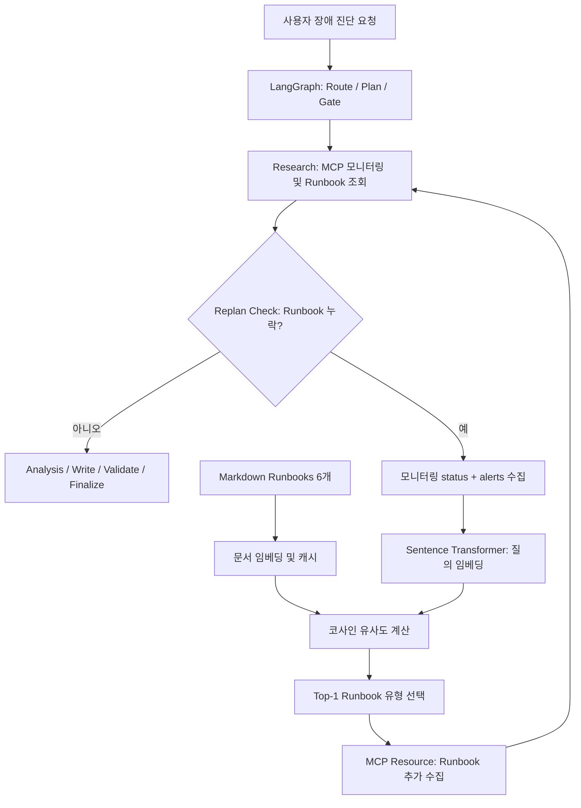

# AI Mini-Project | 최종 결과 보고서

> **RAG 기반 장애 대응 Runbook 검색 개선**  
> **선택 과제 1 — Base AI Project 개선**

| 구분 | 내용 |
|---|---|
| 소속 | **SKALA 광주 2반** |
| 고유번호 | **G043** |
| 성명 | **김아영** |
| 프로젝트명 | RAG 기반 장애 대응 Runbook 검색 개선 |
| 결과 코드 | **https://github.com/kay25802/skala-ai-agent** |
| 평가 환경 | macOS · Python 3.11 가상환경 |

---

## 1. 문제 개선 및 신규 구현 사항

### 1.1 기존 시스템과 문제점

기존 Base AI Agent는 LangGraph로 시스템 장애 대응 절차를 실행하고, MCP를 통해 모니터링 데이터와 Runbook을 수집한다. 그중 Runbook을 추가로 수집해야 하는 재계획 단계에서는 모니터링 알림 문구를 **키워드 규칙**으로 분류해 장애 유형을 선택했다.

- **규칙 우선순위에 의존:** `CPU 99%, latency increased`는 CPU 급증이 포함되어도 먼저 탐지한 `latency`에 따라 `high-latency`로 분류됐다.
- **표현 변화에 취약:** `Server response is extremely slow`는 사전 지정된 키워드가 없어 실제 의미와 무관한 `db-down`으로 분류됐다.
- **잘못된 기본값:** `Storage capacity exhausted`도 매칭 키워드가 없어서 `db-down`으로 분류됐다.

### 1.2 개선 목표 및 핵심 구현

1. **키워드 기반 Runbook 선택을 RAG 방식의 의미 기반 검색으로 변경한다.**
2. **동일한 10개 장애 문항으로 개선 전후 Runbook Top-1 검색 정확도를 비교한다.**

기존 기능을 가능한 유지하고, Runbook 선택 로직과 독립 평가 스크립트만 최소한으로 변경했다.

### 1.3 변경한 소스코드

| 경로 | 변경 사항 |
|---|---|
| `agent/runbook_rag.py` | **신규**: Runbook 6개 임베딩 및 코사인 유사도 기반 Top-1 검색 |
| `agent/graph.py` | **수정**: `_classify_incident_type()`에서 `search_runbook()` 호출 |
| `eval_runbook.py` | **신규**: 기존 키워드 검색과 개선 검색의 정확도 평가 |
| `requirements.txt` | **수정**: `sentence-transformers` 의존성 추가 |

## 2. 적용 기술 요소

### 2.1 이번 개선에서 직접 적용한 기술

- **문서 임베딩 및 의미 검색:** `sentence-transformers/paraphrase-multilingual-MiniLM-L12-v2` 모델로 Markdown Runbook 문서 6개와 장애 입력 문장을 임베딩했다.
- **코사인 유사도 검색:** 질의 벡터와 문서 벡터 사이의 유사도를 계산해 가장 높은 Runbook 1개를 반환했다.
- **캐시:** `@lru_cache(maxsize=1)`로 임베딩 모델 및 Runbook 임베딩 결과를 최초 로딩 후 재사용했다.
- **LangGraph 연동:** `agent/graph.py`의 `replan_check_node()`에서 Runbook이 누락된 경우 `_classify_incident_type()`을 거쳐 의미 검색 결과를 추가 조사 대상으로 지정하도록 연결했다.
- **정량 평가:** 같은 10개 입력·정답 쌍으로 Before/After Top-1 검색 정확도를 계산했다.

> **구현 범위:** 별도 벡터 DB를 구축하지 않고 메모리에 보관한 벡터와 코사인 유사도로 검색했다. 문서 검색 결과를 기존 Agent의 Runbook 조회 과정에 연결한 **간소화된 RAG형 검색 개선**이다.

### 2.2 기존 Base AI Agent에서 활용한 기술

| 기술 요소 | 확인된 적용 범위 |
|---|---|
| **LangGraph / Supervisor 흐름** | `StateGraph` 기반 Route → Plan → Gate → Research → Replan Check → Analysis → Write → Validate → Finalize 흐름. 재계획 및 조건부 분기 사용 |
| **MCP** | `get_monitoring_status` Tool, `get_incident_runbook` Resource, `incident_analysis_prompt` Prompt |
| **모듈화·의존성 주입** | `agent/runbook_rag.py` 분리; 기존 `SupervisorDeps` 및 `functools.partial`로 노드에 의존성 주입 |
| **관측 가능성** | 기존 LangGraph 노드에 LangSmith `@traceable` 선언 |
| **평가** | 신규 `eval_runbook.py`에 의한 검색 함수 단위의 정답 일치율 평가 |

**새로 구현하지 않은 요소:** 전문 서브에이전트 분리, 독립 Vector DB, LLM-as-a-Judge 평가 체계는 이번 개선 범위에 포함되지 않았다. 기존 코드의 LangSmith 추적 선언을 확인했으나, 이번 개선 기능의 실제 추적 결과를 별도로 측정하거나 첨부하지 않았다.

## 3. 구현 결과

### 3.1 아키텍처 및 개선 흐름도



**Before:** `모니터링 문구 → 키워드 포함 여부·규칙 순서 → Runbook 유형 선택`  
**After:** `모니터링 문구 → 문장 임베딩 → Runbook 임베딩과 코사인 유사도 비교 → Top-1 유형 선택`

**적용 범위 유의:** 수정한 검색 로직은 **재계획 과정에서 Runbook이 누락된 경우** 사용된다. Runbook이 이미 확보된 전체 Agent 실행 경로까지 모두 대체한 것은 아니다.

### 3.2 기능 시연 및 평가 방법

**실행 명령**

```bash
python eval_runbook.py
```

`eval_runbook.py`는 사전에 정답 Runbook을 지정한 장애 문항 10개에 대해 기존 `old_search()`와 개선된 `search_runbook()`을 각각 실행하고, 예측 결과와 정답이 같은 비율을 계산한다.

\[
\text{Top-1 정확도} = \frac{\text{정답 Runbook 선택 건수}}{\text{총 테스트 건수}} \times 100
\]

### 3.3 Before / After 실측 비교

| 지표 | Before: 키워드 검색 | After: 의미 검색 |
|---|---:|---:|
| 테스트 입력 | 10개 | 10개 |
| 정답 | 7개 | 10개 |
| 오답 | 3개 | 0개 |
| **Top-1 검색 정확도** | **70.0%** | **100.0%** |

**정확도 변화: +30.0%p** (동일한 10개 문항 기준)

| 입력 문장 | 정답 | 개선 전 | 개선 후 |
|---|---|---|---|
| `CPU 99%, latency increased` | `cpu-spike` | `high-latency` ❌ | `cpu-spike` ✅ |
| `Server response is extremely slow` | `high-latency` | `db-down` ❌ | `high-latency` ✅ |
| `Storage capacity exhausted` | `disk-full` | `db-down` ❌ | `disk-full` ✅ |

나머지 7개 입력에서는 두 방식 모두 정답을 반환했다.

**핵심 확인 결과:** 키워드 순서에 의한 잘못된 선택과 사전에 정의되지 않은 유사 표현을, 이번 10개 테스트에서는 의미 검색으로 보완할 수 있었다.

> **결과 해석 주의:** 100%는 **Runbook 검색 함수에 대한 10개 테스트 정확도**이며, 전체 AI Agent의 최종 진단 정확도나 실서비스 성능을 의미하지 않는다. 전체 Agent의 종단 간 실행 정확도 및 처리 시간은 별도로 측정하지 않았다.

### 3.4 실제 실행 결과 기록

실행 환경에서 다음 최종 집계가 출력되었다.

```text
=== 최종 비교 ===
Before 정확도: 70.0%
After 정확도:  100.0%
정확도 변화:   +30.0%p
```

> 최종 공개 자료에서 시연의 재현성을 높이려면, 위 실행 결과의 **터미널 캡처 화면**을 해당 위치에 추가하면 좋다. 현재 문서에는 제공받은 실행 로그를 텍스트로 기록했다.

## 4. 교훈 및 추가 개선 방향

### 4.1 한계 및 트레이드오프

1. **테스트 규모:** 10개 문항으로 확인한 결과이므로 다른 장애 문구에서도 100%를 보장하지 않는다.
2. **정답 해석:** `CPU 99%, latency increased`처럼 여러 증상이 있는 경우 실제 근본 원인은 추가 조사가 필요하다. 이번 평가에서는 미리 정한 대표 장애 유형을 정답으로 사용했다.
3. **검색 자원 비용:** 키워드 매칭과 달리 임베딩 모델 로딩·추론에 시간과 메모리가 필요하다. 캐시를 적용했지만 소요 시간과 메모리 사용량은 측정하지 않았다.
4. **잘못된 검색 가능성:** 현재는 관련성이 낮아도 가장 유사한 Runbook 하나를 반환한다. 검색 점수 기준 또는 미분류 처리가 없다.
5. **연동 범위:** 재계획 분기에만 적용했으며, 전체 LangGraph 실행 결과가 개선되었는지 검증하는 종단 간 테스트는 수행하지 않았다.

### 4.2 향후 추가 개선 사항

- 테스트 데이터를 확대해 미등록 장애, 한국어 질문, 복합 장애를 평가한다.
- 유사도 임계값을 설정해 근거가 부족할 때 잘못된 Runbook 선택을 막는다.
- 검색 시간·메모리 사용량까지 정량 측정하고, 전체 Agent 실행 경로를 회귀 테스트한다.

### 4.3 수행 소감 및 배운 점

이번 프로젝트에서는 새로운 기능을 많이 추가하기보다 **기존 시스템의 오류가 실제로 발생하는 지점**을 찾아 제한된 범위에서 개선했다. 키워드 방식은 구현이 단순하지만 표현이 달라지면 의도와 다른 결과를 반환할 수 있다는 점을 확인했다. 의미 검색으로 같은 10개 테스트의 정확도가 높아진 것은 의미 있었지만, 작은 평가셋에서의 결과를 전체 시스템의 성능으로 일반화하면 안 된다는 점도 배웠다. 앞으로는 정확도뿐 아니라 처리 시간과 예외 상황까지 함께 확인해 개선의 효과와 비용을 균형 있게 평가하고 싶다.

---

## 부록. 코드 및 재현 정보

| 항목 | 정보 |
|---|---|
| RAG 검색 함수 | `agent/runbook_rag.py` |
| LangGraph 연결 | `agent/graph.py` — `_classify_incident_type()`, `replan_check_node()` |
| 평가 스크립트 | `eval_runbook.py` |
| 문서 데이터 | `data/runbooks/*.md` — 6개 |
| 임베딩 모델 | `sentence-transformers/paraphrase-multilingual-MiniLM-L12-v2` |
| 실행 | `python eval_runbook.py` |
| GitHub | **https://github.com/kay25802/skala-ai-agent** |
